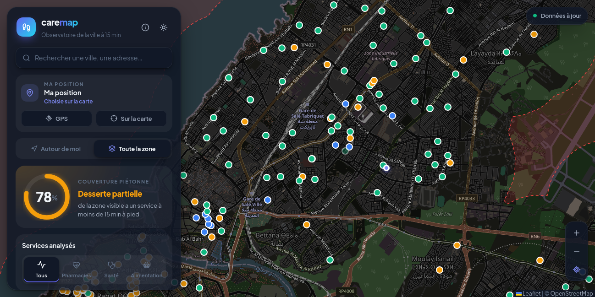
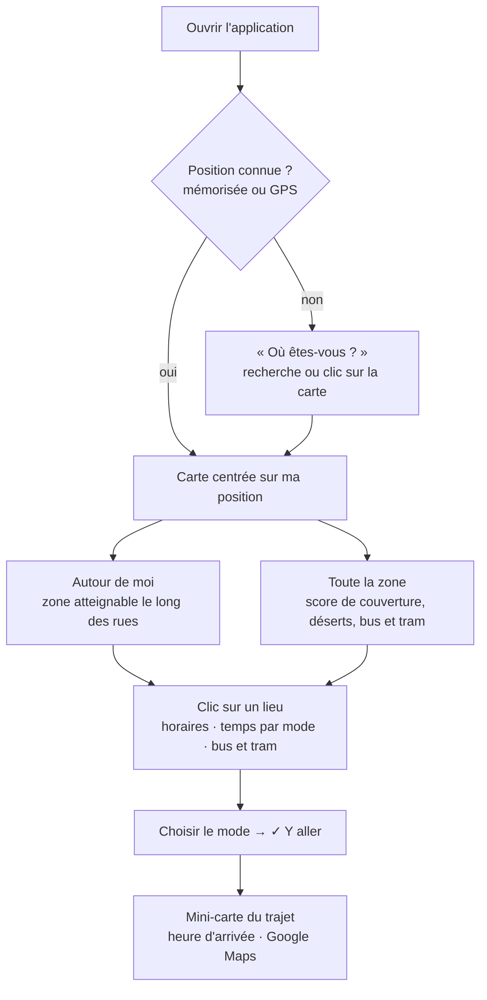
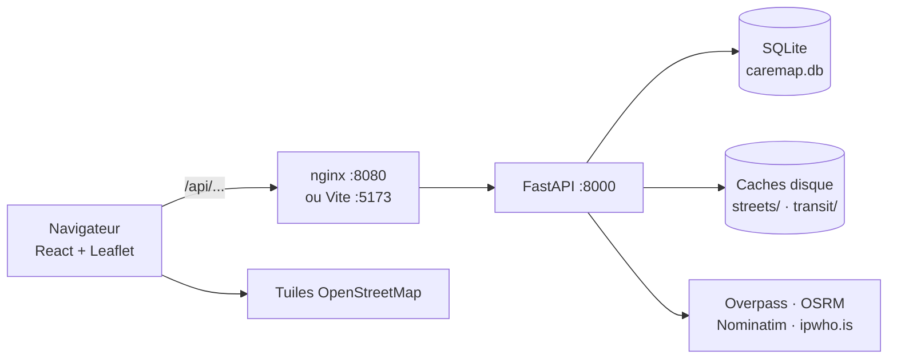
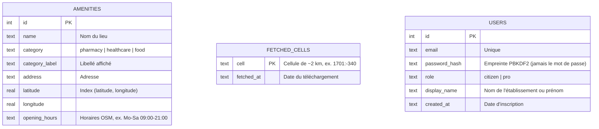

# 🩺 CareMap — Accès aux soins et aux services essentiels

> **Carte interactive de la « ville du quart d'heure » : qu'est-ce que je peux atteindre depuis chez moi, et où sont les déserts de services ?**




CareMap montre à chaque habitant les **pharmacies, services de santé et commerces alimentaires** qu'il peut atteindre à pied depuis sa position, repère les quartiers mal desservis (**« déserts de services »**) et indique comment rejoindre un lieu **à pied, à vélo, à moto, en voiture ou en bus et tram**.

Toutes les données viennent d'**OpenStreetMap** : l'application fonctionne dans n'importe quelle ville, sans base préparée à l'avance et sans clé d'API.

---

## 📋 Table des matières

1. [Fonctionnalités](#-fonctionnalités)
2. [Démarrage rapide (Docker)](#-démarrage-rapide-docker)
3. [Installation pour le développement](#-installation-pour-le-développement)
4. [Comment ça marche](#-comment-ça-marche)
5. [Architecture du projet](#-architecture-du-projet)
6. [Base de données et caches](#-base-de-données-et-caches)
7. [Endpoints de l'API](#-endpoints-de-lapi)
8. [Qualité du code](#-qualité-du-code)
9. [Guide Git de l'équipe](#-guide-git-de-léquipe)
10. [Limites et pistes](#-limites-et-pistes)
11. [Équipe](#-équipe)

---

## ✨ Fonctionnalités

| Fonctionnalité | Description |
| :--- | :--- |
| 📍 **Autour de moi** | Zone atteignable à pied en 5 à 30 min, calculée **le long des vraies rues** ; seuls les services de cette zone sont affichés, le reste est en rouge |
| 🗺️ **Toute la zone** | Score de couverture du quartier visible et tracé des déserts de services (critère des 15 minutes) |
| 👤 **Comptes** | Citoyen (facultatif : l'application reste utilisable sans compte) ou **pro** (pharmacie, supermarché, clinique, hôpital…) ; mots de passe hachés (PBKDF2), connexion par jeton signé |
| ⬡ **Population (H3)** · *comptes pro* | Le quartier découpé en hexagones de ~350 m : population de chaque hexagone, temps d'accès aux 3 services, **nombre d'habitants mal desservis** et zones prioritaires |
| 🚶 **Temps de trajet** | Clic sur un lieu → temps à pied, à vélo, à moto et en voiture, avec l'itinéraire réel tracé |
| 🚋 **Bus et tram** | Lignes et arrêts sur la carte, itinéraires recommandés du plus rapide au plus lent (correspondances comprises) |
| 🕐 **Ouvert / fermé** | Badge « Ouvert · ferme à 21:00 » d'après les horaires OpenStreetMap ; les lieux fermés sont estompés |
| ✅ **Y aller** | Confirme le mode choisi : mini-carte du trajet, heure d'arrivée, lien vers Google Maps |
| 🎯 **Position fiable** | GPS, ou « Où êtes-vous ? » (recherche ou clic sur la carte), mémorisée d'une visite à l'autre |
| 🛡️ **Mode confidentiel** | Pour ne pas partager sa position : arrondie à ~500 m avant tout calcul, jamais enregistrée, ni GPS ni IP automatiques ; le serveur n'écrit ni positions ni adresses IP dans ses journaux |
| 🌗 **Interface** | Thème clair / sombre, version mobile, animations (désactivées si le système demande moins de mouvement) |

---

## 🚀 Démarrage rapide (Docker)

Seul **Docker** est nécessaire :

```bash
git clone https://github.com/oualidechbarthi/caremap.git
cd caremap
docker compose up -d --build
```

Ouvrez **http://localhost:8080** 🎉

```bash
docker compose ps                          # état des conteneurs
docker compose logs -f --tail 100 backend  # journaux du backend
docker compose down                        # tout arrêter
```

> Le dossier `backend/data` est monté dans le conteneur : la base et les caches sont conservés entre deux reconstructions.

> 🌍 **Mettre l'application en ligne** (serveur, HTTPS automatique, nom de domaine) : voir le guide [DEPLOY.md](DEPLOY.md).

---

## 🛠 Installation pour le développement

Prérequis : **Python 3.12**, **Node.js** et **npm**. Les modifications du code apparaissent alors immédiatement.

### Option A — Script automatique

```bash
chmod +x setup.sh
./setup.sh
```

### Option B — Manuellement

**Terminal 1 : backend**

```bash
cd backend
python3 -m venv venv
source venv/bin/activate        # Windows : venv\Scripts\activate
pip install -r requirements.txt
uvicorn app.main:app --reload --port 8000
```

- API : **http://localhost:8000** · documentation interactive : **http://localhost:8000/docs**

**Terminal 2 : frontend**

```bash
cd frontend
npm install
npm run dev
```

- Application : **http://localhost:5173**

> 📱 Depuis un téléphone sur le même Wi-Fi : `hostname -I` donne l'adresse de l'ordinateur (ex. `http://192.168.1.25:8080`). Le GPS y est bloqué par le navigateur (pas de HTTPS) : la carte « Où êtes-vous ? » prend le relais.

---

## 🧭 Comment ça marche



### « Autour de moi » : la marche le long des rues

1. Le réseau piéton autour de ma position est téléchargé **une seule fois** depuis Overpass (pour un trajet de 30 min) puis gardé dans `backend/data/streets/`.
2. Il devient un graphe **NetworkX** ; l'algorithme de **Dijkstra** parcourt les rues depuis ma position jusqu'à épuisement du temps (15 min = 1 125 m à 4,5 km/h).
3. Les tronçons atteints, élargis de 40 m, forment la zone atteignable ; chaque service reçoit son vrai temps de marche.
4. En attendant le plan des rues, une estimation à vol d'oiseau (+30 % de détour) s'affiche en pointillés.

### « Toute la zone » : les déserts de services

1. Un cercle de **15 min × 75 m = 1 125 m**, mesuré en vrais mètres (projection UTM locale), est tracé autour de chaque service visible.
2. Ce qui reste hors de tous les cercles est le **désert de services**.
3. Score : `couverture = 100 − surface du désert ÷ surface visible × 100`.

### Analyse H3 : la population mal desservie

1. La zone visible est découpée en hexagones **H3** (la grille hexagonale d'Uber) de résolution 9 : ~0,1 km², ~350 m de large.
2. Pour chaque hexagone, on calcule le temps de marche vers la pharmacie, le lieu de santé et le commerce alimentaire les plus proches, puis le temps pour avoir **les trois** (le plus long des trois).
3. La population vient de **[Kontur Population](https://www.kontur.io/datasets/population-dataset/)** (licence CC BY 4.0) : un fichier par pays, en hexagones H3 de ~400 m (résolution 8), téléchargé une fois depuis HDX puis gardé dans `backend/data/population/`. Chaque hexagone de 400 m est réparti également entre ses 7 sous-hexagones.
4. Résultat : la carte colore chaque hexagone du vert (≤ 5 min) au rouge (> 20 min), avec une opacité qui suit la population, et le panneau indique **combien d'habitants** vivent à plus de 15 min d'un service et **quelles zones traiter en priorité**.

### Comptes et confidentialité

- **Citoyen** : facultatif. **Pro** (pharmacie, supermarché, clinique…) : obligatoire pour l'analyse de population (`/api/analysis` répond 401 sans compte, 403 pour un compte citoyen).
- Mots de passe : empreinte **PBKDF2-SHA256** avec sel aléatoire (jamais en clair). Connexion : jeton signé **HMAC-SHA256** valable 30 jours, envoyé dans l'en-tête `Authorization: Bearer …`. Clé de signature : variable `CAREMAP_SECRET` ou fichier `backend/data/secret.key` (créé automatiquement, jamais commité).
- La table `users` ne contient **aucune position**. Les journaux d'accès masquent l'IP et les paramètres d'URL (`?lat=…&lon=…`).
- **Mode confidentiel** (bouton « Confidentiel ») : la position est arrondie sur une grille de 0,005° (~500 m) dans le navigateur avant d'être utilisée, rien n'est mémorisé et aucune localisation automatique n'est lancée.

### Trajets et transports

- **À pied, vélo, voiture** : serveurs OSRM d'OpenStreetMap (la moto suit l'itinéraire de la voiture). Estimation « ≈ » si un serveur ne répond pas.
- **Bus et tram** : arrêts et lignes OpenStreetMap ; itinéraires directs, partiels (fin à pied, 20 min max.) ou avec une correspondance (+5 min), plus rapides que la marche, classés du plus rapide au plus lent. Temps hors attente : il n'existe pas d'horaires publics.

---

## 🏗 Architecture du projet



```text
caremap/
├── backend/
│   ├── app/
│   │   ├── main.py              # FastAPI : les 7 endpoints, files de téléchargement en arrière-plan
│   │   ├── db.py                # SQLite : lieux, horaires, cellules téléchargées, migrations
│   │   └── services/
│   │       ├── geo.py           # Lieux OSM (Overpass), déserts et score (Shapely, GeoPandas)
│   │       ├── isochrone.py     # Marche le long des rues (graphe NetworkX, Dijkstra)
│   │       ├── routing.py       # Itinéraires pied / vélo / moto / voiture (OSRM)
│   │       ├── transit.py       # Bus et tram : arrêts, lignes, itinéraires classés
│   │       ├── analysis.py      # Grille H3 : temps d'accès et population par hexagone
│   │       ├── population.py    # Population Kontur (HDX) : téléchargement et cache par pays
│   │       └── location.py      # Recherche d'adresses (Nominatim), pays par IP
│   ├── data/                    # Base et caches (ignorés par Git)
│   ├── scripts/init_db.py       # Initialisation manuelle de la base
│   ├── requirements.txt
│   ├── pyproject.toml           # Configuration Ruff
│   └── Dockerfile               # Python 3.12 + uvicorn, contrôle de santé
│
├── frontend/
│   ├── src/
│   │   ├── App.jsx              # Carte, panneau, modes, trajets, « Y aller », localisation
│   │   ├── components/
│   │   │   ├── SearchBox.jsx    # Recherche de lieux
│   │   │   ├── CoverageGauge.jsx# Anneau du score de couverture
│   │   │   ├── PopulationCard.jsx# Synthèse de l'analyse H3 et zones prioritaires
│   │   │   └── HowItWorks.jsx   # Guide « Comment ça marche »
│   │   ├── openingHours.js      # Lecture des horaires OSM (ouvert / fermé)
│   │   ├── population.js        # Couleurs et infobulles des hexagones H3
│   │   ├── constants.js         # Catégories, couleurs, vitesse de marche
│   │   ├── hooks.js             # Debounce, nombres animés, stockage navigateur
│   │   └── index.css            # Thèmes, verre dépoli, animations, mobile
│   ├── nginx.conf               # Sert l'application et transmet /api au backend
│   ├── Dockerfile               # Build Node puis service nginx
│   └── vite.config.js           # Port 5173 et proxy /api → 8000
│
├── docker-compose.yml           # Backend + frontend en une commande
├── docker-compose.prod.yml      # Mise en ligne : + Caddy (HTTPS automatique)
├── deploy/Caddyfile             # Configuration de Caddy
├── DEPLOY.md                    # Guide de mise en ligne
├── setup.sh                     # Installation automatique (développement)
└── README.md
```

---

## 💾 Base de données et caches

Pas d'ORM : le module natif **`sqlite3`** de Python suffit. La base `backend/data/caremap.db` est créée automatiquement au premier démarrage et ignorée par Git.



| Cache | Contenu |
| :--- | :--- |
| `backend/data/caremap.db` | Lieux, horaires et cellules déjà téléchargées |
| `backend/data/streets/` | Réseau piéton par zone (~500 m), pour « Autour de moi » |
| `backend/data/transit/` | Arrêts, lignes et voies de tram par tuile de ~11 km |
| `backend/data/population/` | Population Kontur par pays : `{ hexagone H3 : habitants }` |
| `backend/data/secret.key` | Clé qui signe les jetons de connexion (à ne jamais partager ni commiter) |

---

## 📡 Endpoints de l'API

| Méthode | Route | Description |
| :--- | :--- | :--- |
| `GET` | `/api/health` | État du serveur et nombre de lieux en cache |
| `GET` | `/api/locate` | Pays approximatif par adresse IP |
| `GET` | `/api/search?q=…` | Recherche d'une ville ou d'une adresse (Nominatim) |
| `GET` | `/api/explore` | « Toute la zone » : lieux, déserts et score de la vue (`min_lat`, `min_lon`, `max_lat`, `max_lon`, `zoom`, `category`, `minutes`) |
| `GET` | `/api/nearby` | « Autour de moi » : zone atteignable, lieux avec temps de marche, plus proche par catégorie (`lat`, `lon`, `minutes`, `category`) |
| `GET` | `/api/trip` | Trajets pied / vélo / moto / voiture et itinéraires bus et tram classés (`from_lat`, `from_lon`, `to_lat`, `to_lon`) |
| `GET` | `/api/transit` | Lignes de tram et arrêts de la vue (`min_lat`, `min_lon`, `max_lat`, `max_lon`, `zoom`) |
| `GET` | `/api/analysis` | **Compte pro requis.** Analyse H3 de la vue : hexagones avec population et temps d'accès, habitants mal desservis, zones prioritaires (`min_lat`, `min_lon`, `max_lat`, `max_lon`, `zoom`, `minutes`) |
| `POST` | `/api/auth/register` | Création de compte (`email`, `password` ≥ 8 caractères, `role` : `citizen` ou `pro`, `display_name`) → jeton + compte |
| `POST` | `/api/auth/login` | Connexion (`email`, `password`) → jeton + compte |
| `GET` | `/api/auth/me` | Compte correspondant au jeton (`null` si absent ou expiré) |

Les téléchargements lents tournent en arrière-plan : la réponse indique `ready`, `loading` (le frontend redemande toutes les 3 s), `unavailable` (nouvel essai après 60 s) ou `zoom_in`.

---

## 🧹 Qualité du code

```bash
# Backend : Ruff (linter + formatage)
pip install -r backend/requirements-dev.txt   # installe Ruff
ruff check backend/ && ruff format backend/

# Frontend : Oxlint + build
cd frontend && npm run check
```

---

## 🌿 Guide Git de l'équipe

```bash
git checkout main && git pull origin main      # 1. Partir de la dernière version
git checkout -b feature/nom-court              # 2. Une branche par modification
# ... modifications, puis vérifier les linters ...
git add . && git commit -m "feat: description" # 3. Commit
git push -u origin feature/nom-court           # 4. Push
```

Puis sur [GitHub](https://github.com/oualidechbarthi/caremap) : **Compare & pull request**, décrire le changement (avec une capture d'écran si possible) et demander une relecture avant de fusionner dans `main`.

Exemples de branches : `feature/filtre-categories`, `fix/popup-carte`, `data/horaires-pharmacies`.

---

## 🚧 Limites et pistes

| Limite | Piste |
| :--- | :--- |
| Données OpenStreetMap incomplètes (horaires, lignes de bus) | Contribuer à OSM, importer les pharmacies de garde |
| Pas d'horaires de bus et tram | Intégrer des données GTFS si elles sont publiées |
| Voiture et moto sans trafic | Service avec trafic ou majoration aux heures de pointe |
| Serveurs publics gratuits (Overpass, OSRM, tuiles) | Serveurs dédiés pour une mise en ligne |
| GPS bloqué hors HTTPS | Déploiement en HTTPS |
| Pas de tests automatisés | Tests de `isochrone.py`, `transit.py`, `openingHours.js` |

---

## 👤 Auteur

- Oualid Echbarthi

---

<sub>Données © contributeurs <a href="https://www.openstreetmap.org/copyright">OpenStreetMap</a> (licence ODbL) · Population : <a href="https://www.kontur.io/datasets/population-dataset/">Kontur Population</a> (licence CC BY 4.0).</sub>
